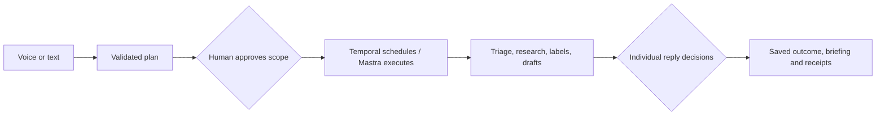

# VOX

**Give VOX the prep. Keep the decisions.**

VOX is an open-source operations co-worker for makers and small teams. Its first working workflow is support: give it a queue, approve a plan, and return to two replies ready for review. Gemma prepares the work; server-side permissions decide what can run.

[Try the hosted workspace](https://getvox.tech/judge) · [Watch the 2:25 walkthrough](https://www.youtube.com/watch?v=K9MYbrX1T74) · [Run local Gemma](docs/LOCAL.md) · [Read the technical evidence](docs/SPONSORS.md)

The preview contains **24 fictional tickets**. Model requests, saved labels, drafts, decisions and workflow history are real. Sends are simulated. This release has no Gmail, Zendesk or other customer-inbox connection.

## Try one complete workflow

Open [getvox.tech/judge](https://getvox.tech/judge). Choose a live evaluation pass or the rules-only demo, then enter:

> Triage all support tickets, research fixes, tag urgent ones, and draft two replies. Ask me before sending anything.

1. Read the proposed plan and approve its scope.
2. Follow triage, research, saved labels and reply preparation.
3. Read each draft, its sources and the advisory review. Approve one simulated send and reject the other.
4. Open the briefing and export the saved evidence.

Live judge access uses a shared allowance of eight sessions. **Three remained after the October 21 verification**; the page shows current availability. Each pass lasts 24 hours and permits repeat plans, voice uploads and briefings, subject to provider quotas and workspace storage bounds. Each run still prepares at most two drafts. Request counters persist, including failed attempts; the owner explicitly removed the former one-plan/one-upload/two-briefing ceilings. The rules-only demo remains available after live passes run out. Only the originating session can approve its drafts. [Judge guide](docs/JUDGES.md).

## Choose how to run it

| Mode | Model and services | What it proves |
| --- | --- | --- |
| Hosted live evaluation | Hosted Gemma, voice, research and connected adapters | Real provider requests and a durable approval workflow |
| Local open-weight AI | Gemma through a loopback-only Ollama endpoint | Local intent normalization, planning and drafting; cloud steps produce explicit skip receipts |
| Rules-only demo | Deterministic priorities and reply templates | The product journey and approval controls, without model inference |

A configured model failure stops at a checkpoint. It never silently becomes a template.

### Local Gemma

Requires Node.js 22.18+, dependencies installed with `npm ci`, Ollama running, and the Temporal CLI on `PATH` (`brew install temporal` on macOS).

```sh
ollama pull gemma3:4b
VOX_MODEL_MODE=local npm run dev
```

Open **http://127.0.0.1:4320/app**. This entry path ignores `.env`, isolates its data and Temporal dev server, accepts only loopback model endpoints, and disables cloud calls. It retains request reservations and the same approval gate. Tested on MacBook Air M4, 16 GB. [Setup, isolation and fallback limits](docs/LOCAL.md).

### Standard development

```sh
npm ci
cp .env.example .env
npm run dev
```

Open **http://localhost:4310**. With no provider credentials, this path uses the labelled rules-only demo. Add server-side credentials to `.env` for provider-backed development; never expose them through Vite variables or commit them. The [environment example](.env.example) lists the settings. [Voice and model configuration](docs/VOICE-FLOW.md) · [Advanced adapters](docs/ADVANCED-INTEGRATIONS.md).

## How execution works



- **Models propose structured data.** Vercel AI SDK streams into fixed React cards. Zod validates the complete plan; partial output and model-generated HTML cannot execute actions. Local Gemma also handles intent normalization; a configured, unexpired Tinker adapter performs that job on the hosted path.
- **Temporal schedules; Mastra runs activities.** Named steps preserve progress and suspend for individual reply decisions. Hosted Temporal persists workflow history in restricted Tiger schemas. Mastra stores snapshots in libSQL.
- **Each provider call reserves its slot first.** Completed responses reuse their saved result. If a request started but has no saved response, automatic replay is blocked because its charge may be uncertain. This is a conservative replay policy, not an exactly-once guarantee for external APIs.
- **Evidence follows saved work.** Application state, cursors, decisions, receipts and the idempotency ledger live in SQLite. Hosted Atlas snapshots must acknowledge writes; startup hydrates local state from them. Sources remain untrusted input. Ultramarine advice cannot authorize a send.
- **The server enforces ownership.** HttpOnly, SameSite session cookies isolate judges. Auth0 binds owner access to a verified allowed identity. Foreign-origin mutations and cross-session decisions are rejected. The public judge route has its own bounded authorization.

[Workflow and voice architecture](docs/VOICE-FLOW.md) · [Provider reservation code](server/provider-task.mjs) · [PRD implementation status](docs/PRD_STATUS.md)

## Measurements and their limits

| Verification | Recorded result | Evidence |
| --- | --- | --- |
| Local Gemma preparation | 24 triaged, 7 labels, 2 drafts in 25.09 s; startup and human review excluded | [Single-run receipt](docs/evidence/lazy-payoff.json) |
| Ten resident-model runs | 10/10 completed; preparation median 17.19 s, p95 31.97 s | [All runs and percentiles](docs/evidence/local-performance.json) |
| Tinker intent LoRA | 12/16 to 16/16 exact matches; median latency rose from 2,385 to 7,870 ms | [Held-out evaluation](docs/evidence/tinker-evaluation.json) |
| Latest hosted voice journey | 24 triaged, 7 labels, 2 drafts, 1 simulated send, 1 rejection; 16 successful receipts; Temporal completed | [October 21 API verification](docs/evidence/hosted-ultramarine-verification.json) |
| Two Ultramarine SDK reviews | Exactly $0.00034095 in existing promotional credit; settled balances and token deltas reconciled | [Actual cost proof](docs/evidence/ultramarine-hosted-cost.json) |
| Hosted restart | Same execution and pending approvals; completed provider calls did not repeat | [Earlier restart proof](docs/evidence/hosted-expansion.json) |

The latest hosted test used a recorded voice file and scripted public-API approvals. Browser interaction was checked separately. It does not establish physical microphone/speaker performance. Ultramarine's measured debit covers those two reviews only; an earlier rejected review consumed a separate $0.00020585. Full multi-provider cost and manual time savings remain unmeasured.

The local planner produced valid schemas in 30/30 cases and the exact requested actions in 19/30. These are authored synthetic tests, not customer accuracy. The real local Qwen fallback, llama.cpp path, physical voice hardware and a second live Auth0 account remain unverified. [Manual timing protocol](docs/LAZY_PAYOFF.md) · [Remaining work](docs/REMAINING.md).

## Verify a change

```sh
npm test
npm run typecheck
npm run build
```

The merged `22fcfa4` build passed **58 tests, typecheck and production build**. [CI receipt](https://github.com/himanshu748/vox-zero-touch-os/actions/runs/39640659579). Automated transport tests cover local-mode isolation, strict review schemas and zero automatic SDK retries. Browser checks cover desktop/mobile layouts, keyboard approval controls and accessible navigation; fresh OS reduced-motion verification was not repeated for the latest copy and product-preview changes.

The dependency audit retains a transitive formatter denial-of-service advisory through Mastra's frontmatter chain, affecting five package entries. VOX does not expose frontmatter parsing or user-controlled format strings. No forced downgrade was applied. [Verification record](docs/VERIFICATION.md).

## Deployment and operating boundaries

The hosted app runs on one free Render service in Virginia. Free hosting may sleep. Use **one application writer**: Atlas revision checks reject concurrent writers, and this is not a horizontally scaled deployment.

For an existing deployment, the build command is `npm ci --include=dev && npm run build`, the start command is `npm start`, and the health route is `/healthz`. Use HTTPS, `PUBLIC_ORIGIN`, Auth0's restricted callback/origin settings, and a server-side secret file selected by `VOX_ENV_FILE`. Atlas allows the service's outbound ranges. Self-hosted Temporal starts with loopback-only RPCs and must pass a provider-free startup workflow before HTTP opens. [Deployment details](docs/ADVANCED-INTEGRATIONS.md).

The project records **18 partner categories**, including Ultramarine, two development tools and the `.tech` domain. DigitalOcean and Arduino are excluded. This count describes implemented uses; it does not guarantee prize eligibility. [Integration ledger](docs/SPONSORS.md).

## Read next

[Published article draft](docs/DEV_POST_DRAFT.md) · [Original PRD](docs/PRD.md) · [Grant readiness and missing user evidence](docs/GRANT_READINESS.md) · [Motion system](docs/MOTION.md) · [Asset provenance](docs/ASSETS.md) · [MIT license](LICENSE)
